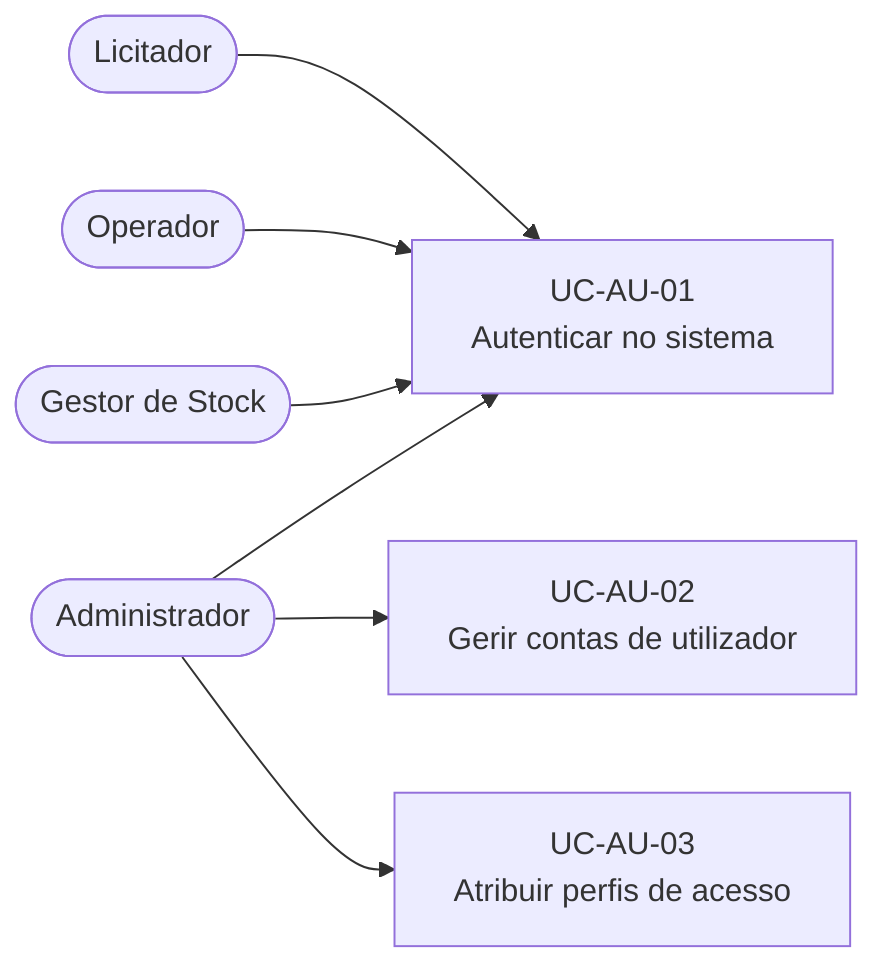
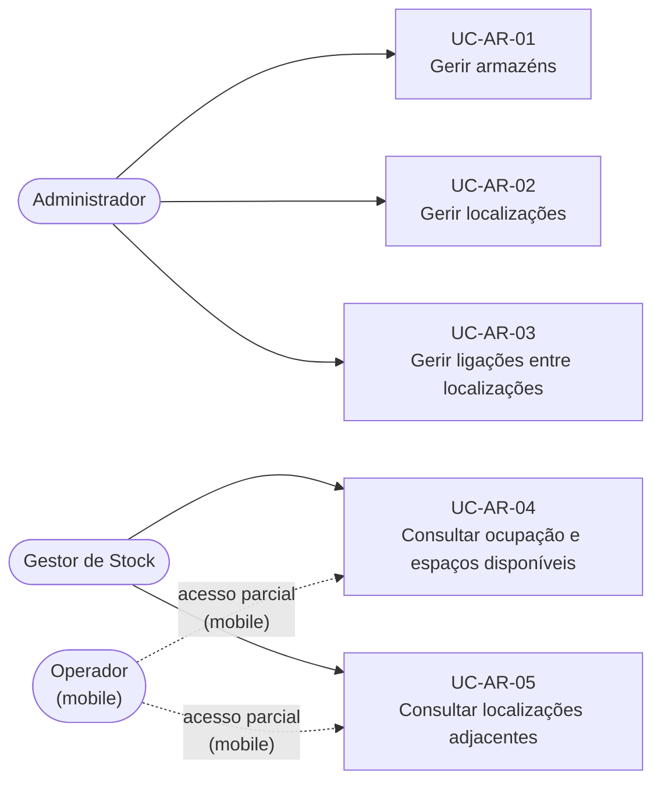
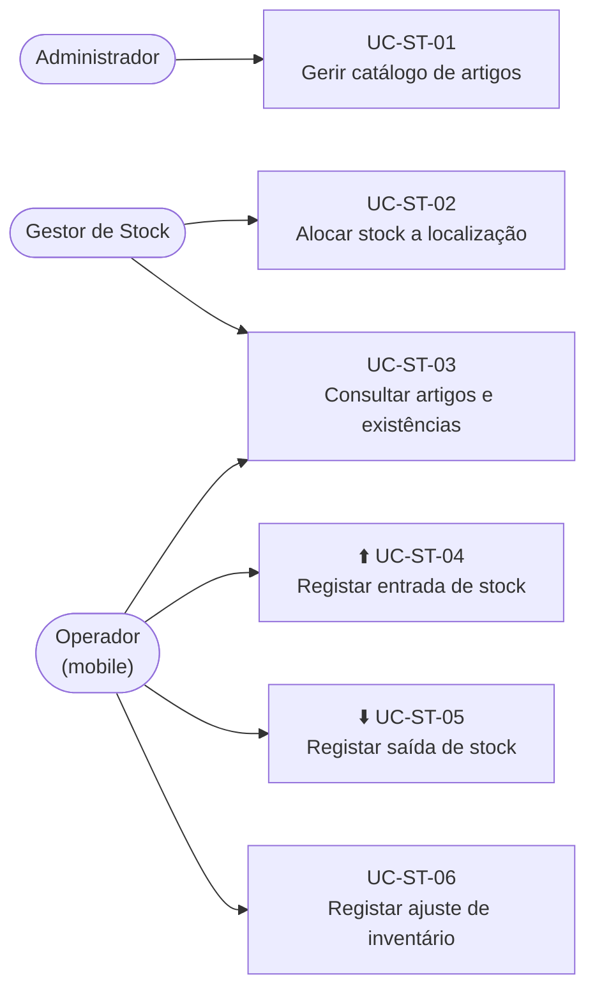
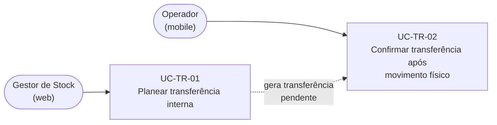
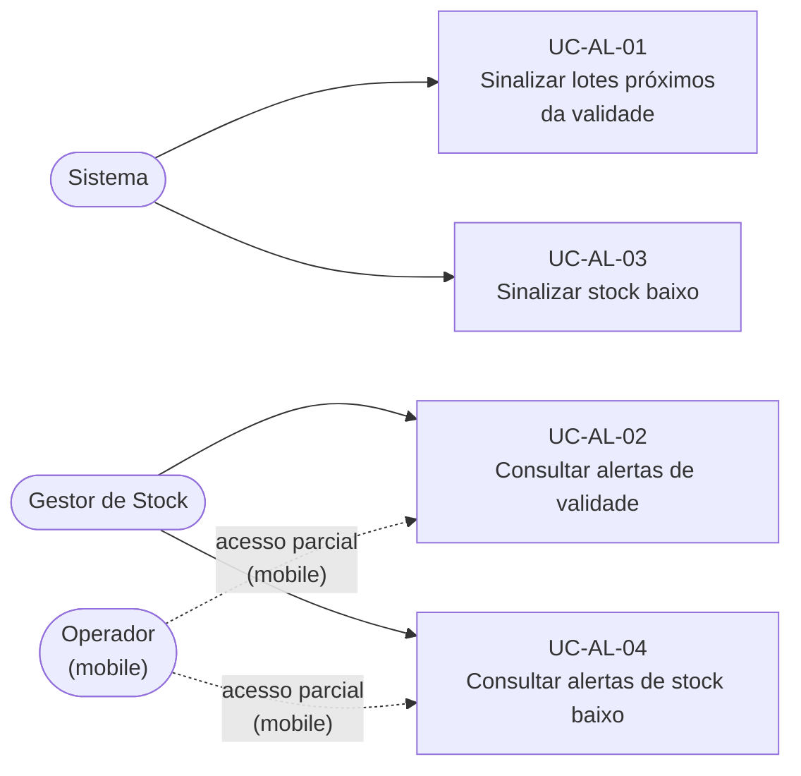
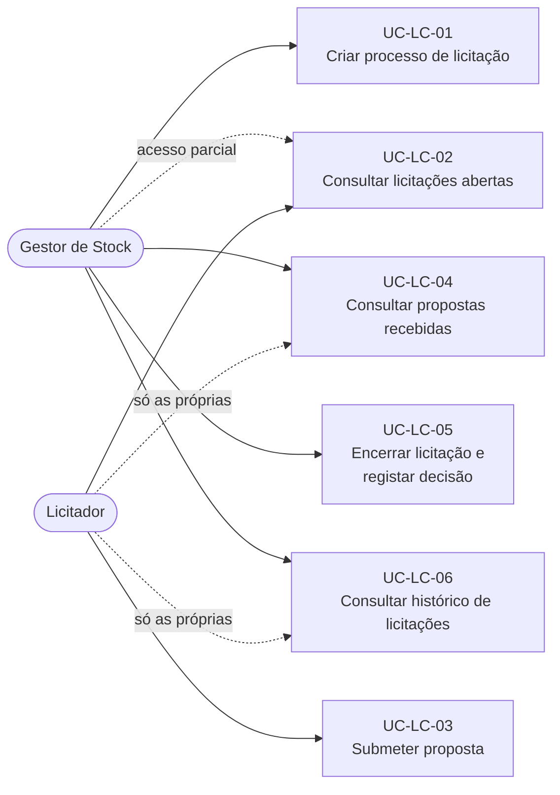

# Casos de Uso — DockIn

## 2. Diagrama de Casos de Uso por Domínio

### 2.1 Autenticação e Controlo de Acesso

---

### 2.2 Gestão de Armazéns e Localizações

---

### 2.3 Artigos e Gestão de Stock

---

### 2.4 Transferências Internas

---

### 2.5 Alertas e Monitorização

---

### 2.6 Licitações

---

## 3. Fluxos Principais (Descrição Textual)

### UC-TR-01/02 — Transferência Interna (fluxo completo)

| Passo | Quem | O quê | Interface |
|---|---|---|---|
| 1 | Gestor de Stock | Identifica necessidade de mover stock | Web |
| 2 | Gestor de Stock | Cria transferência (artigo, lote, qtd, origem, destino) | Web |
| 3 | Sistema | Regista transferência como **Pendente** | — |
| 4 | Operador | Realiza movimento físico no armazém | Campo |
| 5 | Operador | Confirma transferência na app | Mobile |
| 6 | Sistema | Atualiza existências (−origem / +destino) | — |

**Exceções:**
- Origem ou destino inativa → transferência não permitida
- Quantidade insuficiente na origem → não confirmável

---

### UC-LC-01/03/05 — Licitação (fluxo completo)

| Passo | Quem | O quê |
|---|---|---|
| 1 | Gestor de Stock | Cria licitação (armazém, artigos, qtds, prazo) |
| 2 | Sistema | Licitação fica no estado **Aberto** |
| 3 | Licitador | Consulta licitações abertas |
| 4 | Licitador | Submete proposta (valor total, prazo entrega) |
| 5 | Gestor de Stock | Consulta propostas recebidas |
| 6 | Gestor de Stock | Encerra: seleciona proposta **ou** encerra sem seleção |
| 7 | Sistema | Licitação passa a **Encerrado** |

**Exceções:**
- Submeter proposta após prazo → não permitido
- Encerrar licitação sem nenhuma proposta → permitido (sem seleção)

---

### UC-ST-04/05/06 — Operações de Stock pelo Operador

| Caso de Uso | Entrada | Validação | Resultado |
|---|---|---|---|
| **Entrada** | Artigo, lote, qtd, localização, validade (se aplic.) | qtd > 0; lote com info obrigatória | Existências aumentam |
| **Saída** | Artigo, lote, qtd, localização | qtd ≤ disponível | Existências diminuem |
| **Ajuste** | Artigo, lote, localização, nova qtd, justificação | nova qtd ≥ 0 | Existências corrigidas; histórico preservado |
