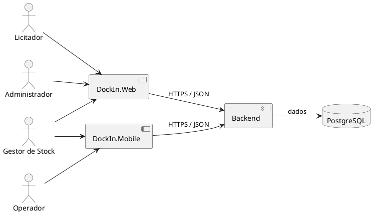
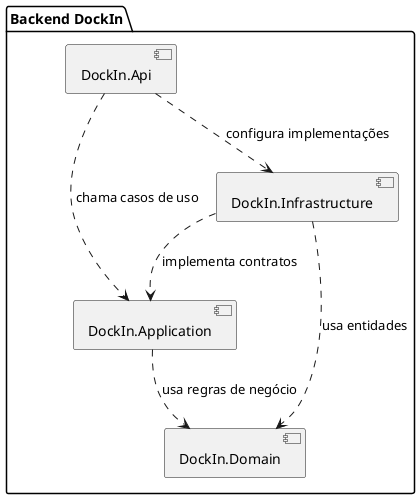
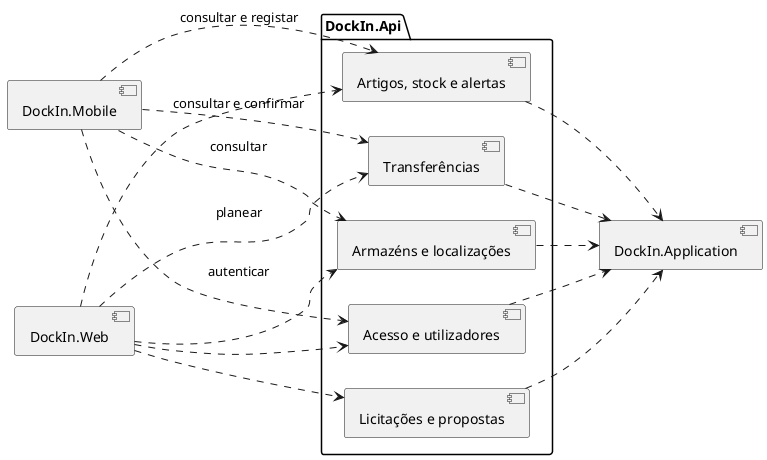
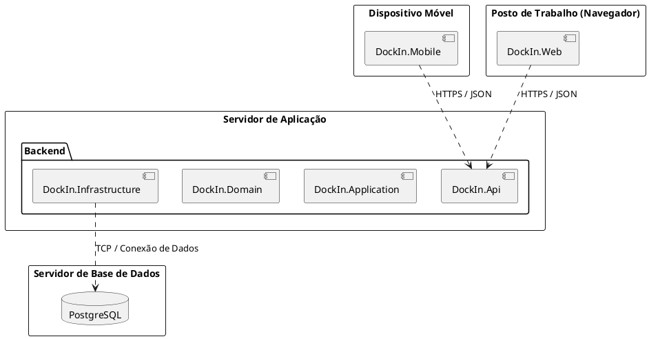

# Documentação da Arquitetura — DockIn

**Artefacto:** M2, versão 01
**Grupo:** G02
**Data:** 28/09/2026

## 1. Objetivo e âmbito

Esta arquitetura inicial define a organização da solução, as responsabilidades e a comunicação entre clientes Web e Mobile, backend e base de dados. No backend define os projetos `DockIn.Api`, `DockIn.Application`, `DockIn.Domain` e `DockIn.Infrastructure`. O sistema cobre utilizadores, armazéns, localizações, artigos, stock, transferências, alertas e licitações para recolha de propostas de eventual fornecimento. Compra, contrato e faturação ficam fora do âmbito (fontes: [PS v04](../04.01-proposta-de-sistema-e-declaracao-de-ambito/m1-proposta-sistema-v04.pdf), secções 2–4; [DA v04](../04.01-proposta-de-sistema-e-declaracao-de-ambito/m1-declaracao-ambito-v04.pdf), secções 2–3).

A divisão em quatro projetos e as decisões técnicas das secções 5–6 são **[Decisões arquiteturais]**, não obrigações expressas na PS/DA. Esta versão define as escolhas necessárias para orientar o desenho seguinte; A Issue aplicável é **I007**, no [Backlog de Projeto m2](../../01-artefactos-de-gestao/01.04-backlog-de-projeto/m2-backlog-projeto-v01.xlsx), linha 11, colunas N–U.

Os quatro diagramas são editáveis **neste ficheiro** em **PlantUML**: as vistas de contexto, componentes, módulos da API e implantação. Cada diagrama tem uma única fonte, no respetivo bloco de código.

**Como alterar os diagramas:** cada elemento tem um identificador curto e um nome visível. Para mudar o nome, editar o texto entre aspas; para mudar uma relação, editar a linha da seta (`-->` ou `..>`). Ao acrescentar um elemento, declarar primeiro o seu identificador e depois as relações. Os identificadores são locais a cada diagrama.

### Contexto da solução

Web e Mobile comunicam com o backend, sem acesso direto à base de dados. O diagrama mostra componentes lógicos, não o número de servidores ou processos. Os clientes pressupõem ligação aos serviços centrais; o funcionamento offline está excluído (fonte: DA, secção 3). Perfis e distribuição por interface: PS, secções 3–4, e DA, secção 2. Tecnologias: [Regulamento Interno do Grupo](../../01-artefactos-de-gestao/01.02-regulamento-de-grupo/m1-regulamento-grupo-v01.md), secção 11.2.

| Componente da solução | Responsabilidade | Relação principal |
|---|---|---|
| `DockIn.Web` | Apresentar as funções de administração, gestão de stock e licitações autorizadas a cada perfil; recolher dados e mostrar respostas. | Chama apenas operações disponibilizadas pela API; a autorização efetiva é feita no backend. |
| `DockIn.Mobile` | Apresentar as consultas autorizadas e as tarefas físicas do Operador, como entradas, saídas, ajustes e confirmação de transferências. | Chama a mesma API; não comunica diretamente com Web nem com PostgreSQL. |
| Backend | Receber pedidos, aplicar permissões e regras, coordenar casos de uso e conservar o resultado das operações. | Serve ambos os clientes e utiliza a infraestrutura para aceder à base de dados. |
| PostgreSQL | Guardar os dados e o histórico necessários à consulta e execução das operações. | Acesso apenas pela infraestrutura do backend; modelo físico detalhado na I008. |

As responsabilidades de Web e Mobile seguem a distribuição da DA, secção 2. A API comum e a relação exclusiva do backend com PostgreSQL são **[decisões arquiteturais]** desta versão.

## 2. Componentes do backend

Diagrama UML de componentes em PlantUML:

**Leitura das setas:** o componente na origem depende do componente no destino. `DockIn.Api` chama casos de uso de `DockIn.Application` e configura as implementações de `DockIn.Infrastructure`. A Application usa as regras de Domain e define os contratos de persistência; Infrastructure implementa esses contratos e usa as entidades de Domain. Domain não depende dos restantes projetos. A chamada à persistência passa pelos contratos da Application, descritos na secção 4. Os quatro projetos executam na mesma aplicação backend.

### Responsabilidades e fronteiras

| Componente | Responsabilidade | Conhece diretamente |
|---|---|---|
| `DockIn.Api` | Receber pedidos, identificar o utilizador, validar a forma do pedido, encaminhar para o caso de uso adequado e transformar o resultado em resposta. Configurar a composição dos componentes. | `DockIn.Application` e configuração de `DockIn.Infrastructure`. |
| `DockIn.Application` | Coordenar casos de uso, autorização por perfil e recurso, transações e contratos de acesso a dados. | `DockIn.Domain`; interfaces de persistência e serviços que ela própria define. |
| `DockIn.Domain` | Definir entidades, estados, invariantes e regras de negócio de stock, transferências e licitações. | Nenhum dos outros três componentes. |
| `DockIn.Infrastructure` | Implementar os contratos de persistência e serviços necessários aos casos de uso. | Contratos de `DockIn.Application` e modelo de `DockIn.Domain` quando necessário para guardar e reconstruir entidades. |

**Fluxo de um pedido:** cliente → `DockIn.Api` → caso de uso em `DockIn.Application` → regras de `DockIn.Domain` → contrato da aplicação → implementação de `DockIn.Infrastructure` → PostgreSQL. A resposta percorre o caminho inverso. A dependência de código da infraestrutura aponta para os contratos da aplicação, embora a execução chegue à infraestrutura por essas interfaces. **[Decisão Arquitetural]** A aplicação delimita operações transacionais e a infraestrutura executa-as na base de dados.

## 3. Vista global dos clientes e módulos da API

Os módulos dentro de `DockIn.Api` representam grupos de operações expostas aos clientes, não aplicações ou serviços independentes. Web e Mobile comunicam com a API por contratos de pedido e resposta; não acedem diretamente a `DockIn.Application`, `DockIn.Domain` ou `DockIn.Infrastructure`. Cada módulo da API encaminha pedidos ao caso de uso correspondente na aplicação.

Cada seta de um cliente indica acesso a operações desse módulo. As permissões e tarefas exatas estão na tabela seguinte; uma seta não concede acesso a todas as operações. Para acrescentar um módulo no desenho, declarar o respetivo componente dentro do package "DockIn.Api", ligar os clientes autorizados a esse componente e acrescentar a dependência desse módulo para App.

| Módulo da API | Web | Mobile | Casos de uso encaminhados para a aplicação |
|---|---|---|---|
| Acesso e utilizadores | Autenticação; gestão pelo Administrador. | Autenticação. | Autenticar, gerir utilizadores e perfis. |
| Armazéns e localizações | Gestão pelo Administrador; consultas pelo Gestor de Stock. | Gestor de Stock consulta existências e localizações diretamente ligadas (F005). | Gerir armazéns, localizações e ligações; consultar existências e adjacência direta. |
| Artigos, stock e alertas | Catálogo pelo Administrador; alocação e consultas pelo Gestor de Stock. | Operador consulta inventário e regista entradas, saídas e ajustes; Gestor de Stock consulta stock baixo; perfil Mobile de validade por confirmar. | Gerir artigos e lotes; consultar existências; alocar e movimentar stock; consultar alertas. |
| Transferências | Planear e consultar pelo Gestor de Stock. | Consultar pendentes e confirmar pelo Operador. | Planear e confirmar transferência. |
| Licitações e propostas | Criar e encerrar pelo Gestor de Stock; consultar e submeter pelo Licitador. | Sem acesso previsto. | Criar processo, consultar, submeter proposta, encerrar e registar decisão. |

F005 e F011 são consultas distintas: o Gestor de Stock consulta localizações e existências no Mobile em F005; o Operador consulta inventário no Mobile em F011. A célula Mobile de F009 não identifica expressamente o perfil de consulta do alerta de validade; atribuí-lo ao Gestor de Stock seria **[inferência]** e fica **Por confirmar** (fontes: PS/DA F005, F009, F011). Os grupos de operações desta tabela seguem PS/DA F001–F019.

## 4. Contratos e regras de comunicação

| Fronteira | Dados trocados | Regra principal |
|---|---|---|
| Web/Mobile → `DockIn.Api` | Identidade da sessão, parâmetros do pedido e dados da operação; resposta ou erro. | A API não confia no perfil indicado pelo cliente; obtém a identidade autenticada. |
| `DockIn.Api` → `DockIn.Application` | Pedido de caso de uso com identidade e dados validados quanto à forma. | A aplicação verifica autorização e regras do processo, incluindo propriedade das propostas. |
| `DockIn.Application` → `DockIn.Domain` | Entidades e operações do domínio. | O domínio protege invariantes como stock não negativo, transições válidas e seleção única. |
| `DockIn.Application` → contratos implementados por `DockIn.Infrastructure` | Carregar, guardar e consultar entidades; unidade de trabalho quando há alterações relacionadas. | Uma confirmação de transferência altera origem, destino e estado de forma indivisível. |

**Interfaces previstas:** a interface externa é a API HTTP/JSON partilhada pelos clientes, com identidade autenticada, operações autorizadas e respostas de sucesso ou erro. A interface interna `Api → Application` expõe casos de uso e respetivos pedidos/resultados; `Application → Domain` aplica operações e invariantes; as interfaces de persistência são definidas na Application e implementadas na Infrastructure. A comunicação `Infrastructure → PostgreSQL` fica limitada à leitura e escrita necessárias. Os nomes de rotas, campos e códigos concretos serão documentados na I015; esta separação conserva as responsabilidades mesmo antes desse contrato detalhado. **[Decisão Arquitetural]** (Fonte para as operações e permissões: PS/DA F001–F019.)

Os contratos concretos da API, nomes de rotas e formatos de resposta pertencem à documentação de API a produzir em `04.11-documentacao-de-api/`. A matriz de permissões por perfil e recurso encontra-se consolidada em [m2-matriz-permissoes-v01.md](../04.20-documentacao-complementar/m2-matriz-permissoes-v01.md).

## 5. Tecnologias e implantação

| Aspeto | Decisão nesta versão e fundamento |
|---|---|
| Clientes | Web em TypeScript/Angular e Mobile em Kotlin/Android, conforme Regulamento Interno, secção 11.2. Cada cliente apresenta as operações que lhe cabem na DA e envia pedidos ao backend. |
| Comunicação cliente–API | **[Decisão Arquitetural]** HTTPS com mensagens JSON e API HTTP; um contrato de API único para Web e Mobile reduz divergências entre clientes. Rotas e esquemas concretos pertencem à I015. |
| Backend | C#/ASP.NET Core sobre .NET 8 LTS, conforme Regulamento Interno, secção 11.2. **[Decisão Arquitetural]** Uma aplicação backend com quatro projetos lógicos, como na secção 2, mantém as regras de domínio separadas do transporte e da persistência. |
| Autenticação e autorização | **[Decisão Arquitetural]** A API autentica cada pedido protegido, obtém a conta e o perfil do contexto autenticado e recusa contas desativadas; a Application autoriza a operação e, quando aplicável, o recurso concreto. A forma da credencial e as rotas serão fechadas na I015 sem mudar esta fronteira. |
| Persistência | PostgreSQL, conforme Regulamento Interno, secção 11.2. **[Decisão Arquitetural]** A Infrastructure concentra o acesso aos dados e executa transações para operações relacionadas. O esquema físico pertence à I008. |
| Alertas | **[Decisão Arquitetural]** A Application calcula o estado de stock baixo e validade próxima a partir dos dados persistidos quando o utilizador consulta os alertas; não é necessário um processo agendado para o âmbito atual. A antecedência concreta vem dos requisitos a fechar. |
| Implantação prevista | **[Decisão Arquitetural]** Num ambiente ligado à rede, uma instância do servidor de aplicação disponibiliza os ficheiros estáticos da Web e a API; o navegador carrega a Web, a aplicação Android corre no dispositivo, e ambos acedem à API por HTTPS. O backend acede a PostgreSQL por ligação restrita. Não se assume alojamento comercial nem disponibilidade de produção, excluídos na DA, secção 3. |

Vista de implantação em PlantUML, com caixas simples:

As caixas exteriores indicam onde cada aplicação executa. O Backend reúne os quatro projetos da secção 2 e usa as transações descritas nas secções 4 e 6. Para mudar onde um elemento executa, mover a sua linha `rectangle` para a caixa exterior correspondente e conservar o identificador nas setas. Esta vista usa retângulos simples para representar os ambientes e aplicações. A localização física dos ambientes, o fornecedor de alojamento e as portas concretas são decisões de configuração posteriores, sem efeito na distribuição de responsabilidades desta arquitetura.

## 6. Restrições e decisões arquiteturais

| ID | Decisão / restrição | Consequência e fundamento |
|---|---|---|
| ARQ-01 | Autorizar cada caso de uso segundo perfil e recurso (PS/DA F001, F019). | Licitadores consultam apenas as próprias propostas; ocultar uma opção no cliente não constitui autorização. |
| ARQ-02 | Conservar o histórico exigido de movimentos e ajustes (PS/DA F008, F012–F014). | Ajustes conservam valor anterior, nova quantidade, justificação, responsável e data; transferências conservam artigo, lote, quantidade, responsável e data. |
| ARQ-03 | **[Decisão Arquitetural]** Confirmar transferência numa única transação para cumprir PS/DA F007–F008. | Débito na origem, crédito no destino e mudança de estado ocorrem juntos; falha mantém o estado anterior. |
| ARQ-04 | Validar estado e prazo da licitação e limitar a seleção a uma proposta (PS/DA F015–F019). | Propostas fora de prazo ou após encerramento são recusadas; pode haver encerramento sem seleção. |
| ARQ-05 | Manter armazéns e artigos inativos no histórico, sem as novas operações vedadas (PS/DA F002, F004). | Preserva rastreabilidade sem permitir alocação em armazém inativo. |
| ARQ-06 | Apresentar existências por localização e localizações diretamente ligadas (PS/DA F005). | A adequação física do espaço é avaliada pelo utilizador; não calcular capacidade, percentagem de ocupação ou espaço livre (PS/DA F006). |
| ARQ-07 | Terminar o processo na decisão sobre propostas (PS/DA F018; DA, secção 3). | Selecionar uma proposta não cria stock nem inicia compra, contrato ou faturação. |

### Restrições e padrões de organização

| Tema | Aplicação nesta arquitetura | Fonte / estatuto |
|---|---|---|
| Distribuição funcional | Administração de contas, catálogo e estrutura na Web; registo de entradas, saídas, ajustes e confirmação física no Mobile; licitações apenas na Web. | PS/DA F001–F019. |
| Limites do produto | Sem cálculo de capacidade física, conversão entre unidades, funcionamento offline, integrações externas ou ciclo comercial após a decisão da licitação. | PS/DA F004/F006/F018; DA, secção 3. |
| Tecnologia | C#/ASP.NET Core/.NET 8 LTS, Angular/TypeScript, Kotlin/Android e PostgreSQL. | Regulamento Interno, secção 11.2. |
| Separação de responsabilidades | Clientes apresentam tarefas; Api trata transporte; Application coordena e autoriza; Domain guarda regras; Infrastructure implementa persistência. As dependências de código apontam para contratos e regras internas. | **[Decisão Arquitetural]**; secções 1–4. |
| Agrupamento funcional | Os módulos da API agrupam operações relacionadas, sem criar serviços independentes ou bases de dados por módulo. | **[Decisão Arquitetural]**; secção 3. |

O padrão de separação descrito na tabela orienta a implementação dos quatro projetos. Não impõe uma estrutura de pastas ou classes além das fronteiras e dependências aqui definidas.

### Alternativas consideradas para as decisões propostas

| Decisão | Alternativa considerada | Escolha e motivo | Limite |
|---|---|---|---|
| Organização do backend | Um único projeto com API, regras e persistência misturadas; ou serviços separados por área. | Quatro projetos lógicos numa aplicação: permite isolar regras e dependências sem exigir comunicação entre serviços. | Não fixa quatro processos nem impede reorganização após decisão formal. |
| Comunicação dos clientes | Contratos separados para Web e Mobile. | Uma API HTTPS/JSON partilhada: as regras e permissões são verificadas no mesmo backend. | Operações e formatos concretos serão documentados na I015. |
| Consistência das transferências | Atualizar origem, destino e estado em gravações independentes. | Uma transação: evita saldos parciais se uma gravação falhar. | A estratégia concreta de concorrência é detalhada na I008/I015. |
| Alertas | Manter avisos materializados por processo agendado. | Calcular na consulta: o estado deriva diretamente das existências e validades atuais, sem introduzir serviço adicional. | Rever apenas se requisitos de volume/desempenho medidos o exigirem. |
| Implantação | Um serviço remoto por componente lógico. | Uma instância de backend e PostgreSQL como topologia inicial: é suficiente para integrar os clientes no âmbito académico. | O alojamento físico e a disponibilidade de produção não fazem parte do âmbito (DA, secção 3). |

## 7. Atributos de qualidade

| Atributo | Medida arquitetural | Verificação prevista |
|---|---|---|
| Segurança | Identidade verificada na API e autorização por perfil e recurso na aplicação. | Tentar operações com perfil indevido, utilizador inativo e acesso a propostas de outro Licitador. |
| Integridade | Regras de domínio e transações para alterações relacionadas. | Simular falha durante transferência e encerramento; verificar ausência de alterações parciais. |
| Auditabilidade | Conservar movimentos, responsáveis, datas e decisões. | Reconstruir quem alterou stock e quem encerrou uma licitação. |
| Usabilidade | Contratos adequados às tarefas Web e Mobile, com erros compreensíveis. | Executar os fluxos principais dos quatro perfis. |
| Manutenibilidade | Dependências apontam para domínio e contratos da aplicação. | Alterar persistência sem mudar regras de domínio. |
| Desempenho | Consultas filtradas para artigos, existências e históricos; paginação quando o volume exigir. | Medir com dados representativos; metas numéricas dependem dos requisitos não funcionais. |

## 8. Evolução prevista

| Momento | Evolução da solução | Consequência para esta arquitetura |
|---|---|---|
| `m2` — desenho | Consolidar requisitos, permissões, casos de uso, modelo de dados e contrato da API, além desta arquitetura. | Conferir as fronteiras e atualizar uma nova versão deste documento se alguma decisão aprovada as alterar. Não apresentar rascunhos relacionados como implementação concluída. |
| `m3` — backend | Implementar a API, casos de uso, regras de domínio, infraestrutura e persistência, com os testes e evidências exigidos. | Verificar na implementação as dependências propostas, autorização, histórico e integridade das transferências; registar desvios aprovados. |
| `m4` — clientes | Implementar e integrar Web e Mobile com o backend dentro da distribuição da DA. | Confirmar que ambos usam os contratos da API, sem acesso direto à base de dados, e que as operações aparecem apenas nas interfaces previstas. |

Esta sequência acompanha as entregas de `m2`, `m3` e `m4` do [Regulamento da UC](../../../lds-regulamento-funcionamento-uc-v19.md), secções 17 e 19. **[Decisão Arquitetural]** As decisões de comunicação, divisão interna e persistência mantêm-se como referência entre milestones; uma alteração material deve ser justificada, revista e versionada, preservando o histórico. A evolução prevista não acrescenta funcionalidades ao âmbito aprovado nem pressupõe alojamento comercial.

## 9. Rastreabilidade e pontos a fechar

As funcionalidades da PS são usadas nesta matriz porque a especificação m2 referida na I001 ainda não foi localizada nesta cópia. A matriz é uma correspondência arquitetural, não substitui a RTM nem a especificação aprovada.

| Fonte funcional | Componentes responsáveis | Decisão / vista que a suporta |
|---|---|---|
| F001 | Web/Mobile; Api; Application; Infrastructure | Autenticação e autorização centralizadas; ARQ-01; vistas de contexto e módulos. |
| F002–F004 | Web; Api; Application; Domain; Infrastructure | Administração, regras de inativação e unidade do artigo; ARQ-05; vista de módulos. |
| F005–F006 | Web/Mobile para consulta; Web para alocação; backend para validação | Consulta de existências/adjacência e alocação sem capacidade física; ARQ-06; vista de módulos. |
| F007–F008 | Web para planeamento; Mobile para confirmação; backend e PostgreSQL | Confirmação transacional e histórico; ARQ-02/03; vistas de backend e implantação. |
| F009–F010 | Web/Mobile nos limites da DA; Application; Infrastructure | Alertas calculados na consulta; vista de módulos; perfil Mobile de F009 por confirmar. |
| F011–F014 | Web/Mobile nos limites da DA; Application; Domain; Infrastructure | Consulta, entradas, saídas e ajustes validados e persistidos; ARQ-02; vista de módulos. |
| F015–F019 | Web; Api; Application; Domain; Infrastructure | Estados/prazos, acesso às propostas próprias e decisão manual sem efeito no stock; ARQ-01/04/07. |

Os atributos de qualidade da secção 7 concretizam as preocupações não funcionais pedidas na I007: segurança, integridade, auditabilidade, usabilidade, manutenibilidade e desempenho. Não se atribuem IDs de requisitos m2 inexistentes nesta cópia. Para aprofundar cada área, consultar [casos de uso](../04.04-casos-de-uso/m2-especificacoes-casos-uso-v01.md), [modelo de dados](../04.06-modelos-de-dados/modelo-de-dados.md), [diagrama de classes](../04.07-modelos-de-classes/m2-modelo-classes-backend-v02.md) e [modelos de comportamento](../04.08-modelos-de-comportamento/m2-diagrama-estados-licitacao-v01.md). Divergências destes rascunhos com PS/DA devem ser resolvidas antes da implementação.

**Decisões essenciais fixadas nesta proposta para o desenho seguinte:** uma API comum aos dois clientes; autorização no backend por perfil e recurso; separação lógica Api/Application/Domain/Infrastructure; PostgreSQL como armazenamento; transação na confirmação da transferência; cálculo de alertas na consulta; topologia lógica da secção 5. O Revisor verifica a coerência e fundamentação destas escolhas; a aprovação formal pertence ao fluxo da I007.

**Detalhes dependentes de outras Issues ou de esclarecimento de requisitos:** rotas e esquemas da API (I015); esquema físico e concorrência de escrita (I008); versões concretas não indicadas no Regulamento Interno; precisão por unidade e antecedência dos alertas (PS/DA F004/F009); semântica detalhada de prazos (F015–F017); perfil Mobile de F009 (DA F009). Estes pontos não alteram as fronteiras entre componentes definidas aqui e não são apresentados como requisitos resolvidos.

## 10. Índice de evidências para a revisão da I007

Este índice remete para os critérios da coluna N e para as evidências da coluna O da I007 no Backlog. O Revisor confirma o cumprimento e regista a sua decisão no relatório próprio; este índice não é uma autoaprovação.

| Critério da I007 | Evidência neste artefacto |
|---|---|
| Componentes, responsabilidades e interfaces definidos | Secções 1–4; vistas de contexto, backend e módulos; tabelas de responsabilidades e contratos. |
| Tecnologias e persistência identificadas | Secção 5, com fonte no Regulamento Interno, secção 11.2. |
| Comunicação e implantação previstas descritas | Secções 4–5; vista de implantação e canais entre os nós. |
| Decisões justificadas | Secção 6; regras ARQ-01–07 e alternativas consideradas. |
| Restrições, padrões e evolução previstos no Regulamento da UC | Secção 6, tabela de restrições e padrões; secção 8, evolução `m2`–`m4`. |
| Requisitos não funcionais considerados | Secção 7; medidas e verificações previstas para seis atributos. |
| Autorização, histórico e consistência suportados | Secções 4 e 6; ARQ-01–04 e fluxos transacionais. |
| Diagramas legíveis com fonte textual | Quatro diagramas editáveis neste Markdown em PlantUML, nas secções 1–3 e 5. A legibilidade será apreciada pelo Revisor. |
| Decisões essenciais para o desenho seguinte resolvidas | Secções 6 e 9; escolhas arquiteturais fixadas nesta proposta e detalhes atribuídos a Issues posteriores. |

**Pacote de evidências do Executor:** este Markdown versionado com os quatro diagramas em código, decisões e alternativas da secção 6 e matriz de correspondência da secção 9. A verificação independente, o registo de defeitos, a classificação e a aceitação pertencem ao Revisor, Auditor e Sprint Review, conforme a [DoD](../../02-artefactos-de-qualidade-de-processo/02.02-definition-of-ready-e-done/m1-definition-of-done-v01.md), secções 3.3–3.6.
