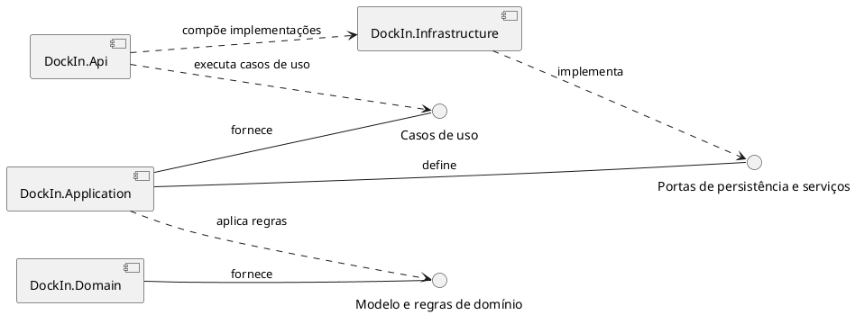
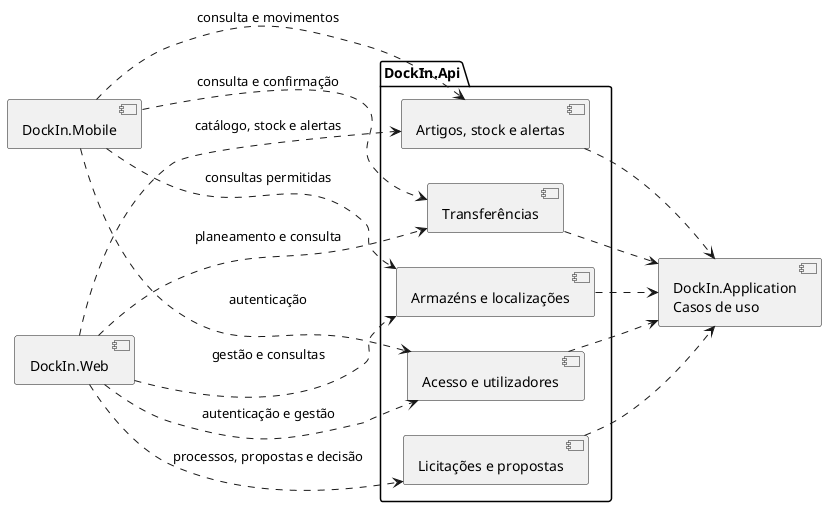

# Documentação da Arquitetura — DockIn

**Artefacto:** M2, versão 01  
**Grupo:** G02  
**Estado:** proposta técnica para validação

## 1. Objetivo e âmbito

Esta arquitetura define as responsabilidades e a comunicação entre `DockIn.Api`, `DockIn.Application`, `DockIn.Domain` e `DockIn.Infrastructure`. Uma segunda vista mostra como os clientes Web e Mobile acedem aos módulos expostos pela API. O sistema cobre utilizadores, armazéns, localizações, artigos, stock, transferências, alertas e licitações para recolha de propostas de eventual fornecimento. Compras, encomendas, contratos, faturação e pagamentos ficam fora do âmbito.

## 2. Componentes do backend

As setas tracejadas indicam **dependência entre componentes**. `DockIn.Api` recebe pedidos e chama casos de uso de `DockIn.Application`. A aplicação usa o modelo de `DockIn.Domain` e define contratos para persistência e serviços externos. `DockIn.Infrastructure` implementa esses contratos. A API liga as implementações às interfaces na composição da aplicação; isso não significa que os casos de uso dependam diretamente da infraestrutura.

### Responsabilidades e fronteiras

| Componente | Responsabilidade | Conhece diretamente |
|---|---|---|
| `DockIn.Api` | Receber pedidos, identificar o utilizador, validar a forma do pedido, encaminhar para o caso de uso adequado e transformar o resultado em resposta. Configurar a composição dos componentes. | `DockIn.Application` e configuração de `DockIn.Infrastructure`. |
| `DockIn.Application` | Coordenar casos de uso, autorização por perfil e recurso, transações e contratos de acesso a dados. | `DockIn.Domain`; interfaces de persistência e serviços que ela própria define. |
| `DockIn.Domain` | Definir entidades, estados, invariantes e regras de negócio de stock, transferências e licitações. | Nenhum dos outros três componentes. |
| `DockIn.Infrastructure` | Implementar os contratos de persistência e serviços necessários aos casos de uso. | Contratos de `DockIn.Application` e modelo de `DockIn.Domain` quando necessário para guardar e reconstruir entidades. |

**Fluxo de um pedido:** cliente → `DockIn.Api` → caso de uso em `DockIn.Application` → regras de `DockIn.Domain` → contrato da aplicação → implementação de `DockIn.Infrastructure` → armazenamento. A resposta percorre o caminho inverso. A dependência de código da infraestrutura aponta para os contratos da aplicação, embora a execução chegue à infraestrutura por essas interfaces.

### Padrão arquitetural

Esta organização segue **Clean Architecture** e o princípio de **inversão de dependências**: `DockIn.Domain` não depende das restantes camadas; `DockIn.Application` depende do domínio e define os contratos; `DockIn.Infrastructure` implementa esses contratos; `DockIn.Api` é o ponto de entrada e a raiz de composição (*composition root*).

## 3. Vista global dos clientes e módulos da API

Os módulos dentro de `DockIn.Api` representam grupos de operações expostas aos clientes, não aplicações ou serviços independentes. Web e Mobile comunicam com a API por contratos de pedido e resposta; não acedem diretamente a `DockIn.Application`, `DockIn.Domain` ou `DockIn.Infrastructure`. Cada módulo da API encaminha pedidos ao caso de uso correspondente na aplicação.

| Módulo da API | Web | Mobile | Casos de uso encaminhados para a aplicação |
|---|---|---|---|
| Acesso e utilizadores | Autenticação; gestão pelo Administrador. | Autenticação. | Autenticar, gerir utilizadores e perfis. |
| Armazéns e localizações | Gestão pelo Administrador; consultas pelo Gestor de Stock. | Consultas permitidas ao Operador. | Gerir armazéns, localizações e ligações; consultar ocupação e adjacência. |
| Artigos, stock e alertas | Catálogo pelo Administrador; alocação e consultas pelo Gestor de Stock. | Consultar artigos e alertas; registar entradas, saídas e ajustes. | Gerir artigos e lotes; consultar existências; alocar e movimentar stock; consultar alertas. |
| Transferências | Planear e consultar pelo Gestor de Stock. | Consultar pendentes e confirmar pelo Operador. | Planear e confirmar transferência. |
| Licitações e propostas | Criar e encerrar pelo Gestor de Stock; consultar e submeter pelo Licitador. | Sem acesso previsto. | Criar processo, consultar, submeter proposta, encerrar e registar decisão. |

## 4. Contratos e regras de comunicação

| Fronteira | Dados trocados | Regra principal |
|---|---|---|
| Web/Mobile → `DockIn.Api` | Identidade da sessão, parâmetros do pedido e dados da operação; resposta ou erro. | A API não confia no perfil indicado pelo cliente; obtém a identidade autenticada. |
| `DockIn.Api` → `DockIn.Application` | Pedido de caso de uso com identidade e dados validados quanto à forma. | A aplicação verifica autorização e regras do processo, incluindo propriedade das propostas. |
| `DockIn.Application` → `DockIn.Domain` | Entidades e operações do domínio. | O domínio protege invariantes como stock não negativo, transições válidas e seleção única. |
| `DockIn.Application` → contratos implementados por `DockIn.Infrastructure` | Carregar, guardar e consultar entidades; unidade de trabalho quando há alterações relacionadas. | Uma confirmação de transferência altera origem, destino e estado de forma indivisível. |

Os contratos concretos da API, nomes de rotas e formatos de resposta pertencem à documentação de API. A [matriz de permissões](../04.20-documentacao-complementar/m2-matriz-permissoes-v01.md) define o acesso por perfil e por recurso.

## 5. Tecnologias e implantação

| Aspeto | Decisão nesta versão |
|---|---|
| Backend | C#, ASP.NET Core e .NET 8 LTS, conforme o Regulamento Interno do Grupo. A separação lógica mantém `DockIn.Api`, `DockIn.Application`, `DockIn.Domain` e `DockIn.Infrastructure`. |
| Frontend Web | TypeScript e Angular; Node.js LTS e npm como ambiente e ferramenta de construção indicados no Regulamento Interno. |
| Frontend Mobile | Kotlin e Android SDK; Gradle como ferramenta de construção indicada no Regulamento Interno. |
| Base de dados | PostgreSQL, conforme o Regulamento Interno do Grupo. |

O Regulamento Interno não fixa outras versões para estas tecnologias nesta tabela; este documento não as introduz. Os contratos concretos de comunicação e a implantação serão detalhados nos artefactos técnicos correspondentes.

## 6. Restrições e decisões arquiteturais

| ID | Decisão / restrição | Consequência |
|---|---|---|
| DA-01 | Autorizar cada caso de uso segundo perfil e recurso. | Licitadores consultam apenas as próprias propostas; ocultar uma opção no cliente não constitui autorização. |
| DA-02 | Registar movimentos de stock com responsável, data, quantidades e justificação de ajustes. | O histórico permite reconstruir alterações. |
| DA-03 | Confirmar transferência numa única transação. | Débito na origem, crédito no destino e mudança de estado ocorrem juntos; falha mantém o estado anterior. |
| DA-04 | Validar estado e prazo da licitação e limitar a seleção a uma proposta. | Propostas fora de prazo ou após encerramento são recusadas; pode haver encerramento sem seleção. |
| DA-05 | Manter armazéns e localizações inativos no histórico, sem novas operações sobre eles. | Preserva rastreabilidade. |
| DA-06 | Apresentar ocupação e espaços disponíveis como apoio. | A adequação física do espaço é avaliada pelo utilizador; não há promessa de cálculo automático de capacidade. |
| DA-07 | Terminar o processo na decisão sobre propostas. | Selecionar uma proposta não altera stock nem inicia compras, encomendas, contratos, faturação ou pagamentos. |

## 7. Atributos de qualidade

| Atributo | Medida arquitetural | Verificação prevista |
|---|---|---|
| Segurança | Identidade verificada na API e autorização por perfil e recurso na aplicação. | Tentar operações com perfil indevido, utilizador inativo e acesso a propostas de outro Licitador. |
| Integridade | Regras de domínio e transações para alterações relacionadas. | Simular falha durante transferência e encerramento; verificar ausência de alterações parciais. |
| Auditabilidade | Conservar movimentos, responsáveis, datas e decisões. | Reconstruir quem alterou stock e quem encerrou uma licitação. |
| Usabilidade | Contratos adequados às tarefas Web e Mobile, com erros compreensíveis. | Executar os fluxos principais dos quatro perfis. |
| Manutenibilidade | Dependências apontam para domínio e contratos da aplicação. | Alterar persistência sem mudar regras de domínio. |
| Desempenho | Consultas filtradas para artigos, existências e históricos; paginação quando o volume exigir. | Medir com dados representativos; metas numéricas dependem dos requisitos não funcionais. |

## 8. Rastreabilidade e pontos a fechar

Os artefactos de referência para m2 seguem a nomenclatura oficial: `m2-especificacoes-casos-uso-v01.md`, `m2-modelo-de-dados-<nome-da-base-de-dados>-v01.md` e `m2-modelo-classes-<modulo>-v01.md`. Os dois últimos mantêm os identificadores variáveis até existir nome aprovado para cada ficheiro. Consultar também os [diagramas de comportamento](../04.08-modelos-de-comportamento/modelos-de-comportamento.md) e a [matriz de permissões](../04.20-documentacao-complementar/m2-matriz-permissoes-v01.md). Os contratos concretos da API e as metas quantitativas serão definidos nos respetivos artefactos, sem alterar as tecnologias já aprovadas.

### Evolução prevista

A arquitetura será concretizada incrementalmente, preservando as fronteiras entre `DockIn.Api`, `DockIn.Application`, `DockIn.Domain` e `DockIn.Infrastructure`. Os contratos da API, a persistência e os clientes Web e Mobile serão detalhados nos respetivos artefactos técnicos à medida que forem especificados e implementados.
