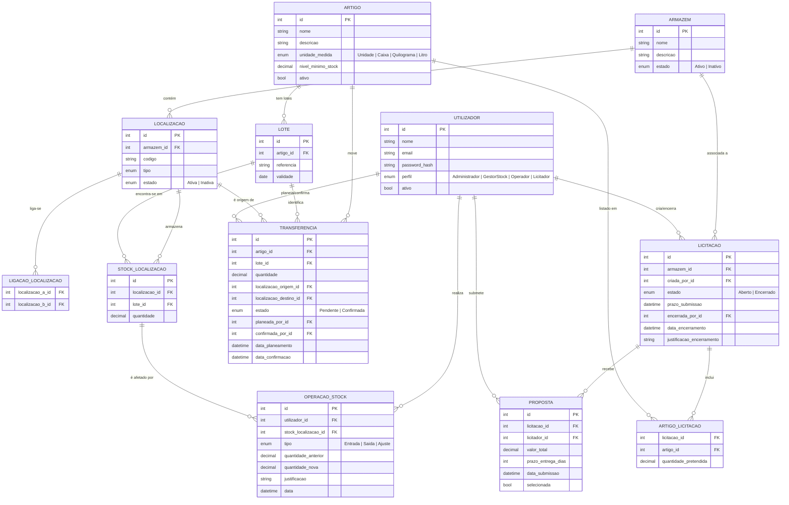

# Modelo de Dados — DockIn

---

## 1. Diagrama Entidade-Relação

---

## 2. Descrição das Entidades

### `UTILIZADOR`
Representa qualquer utilizador do sistema. O campo `perfil` determina o que pode fazer (RBAC). Um utilizador **inativo** não consegue autenticar.

### `ARMAZEM`
Entidade raiz da hierarquia física. Um armazém **inativo** mantém o histórico mas não aceita novas operações.

### `LOCALIZACAO`
Espaço físico dentro de um armazém (prateleira, zona, etc.). Uma localização **inativa** não pode receber alocações ou transferências.

### `LIGACAO_LOCALIZACAO`
Relação bidirecional entre duas localizações **do mesmo armazém**. Permite calcular adjacências (grafo não dirigido). Não podem existir ligações duplicadas nem entre armazéns diferentes.

### `ARTIGO`
Produto gerido pelo sistema. Tem uma única `unidade_medida` que define a precisão das quantidades. A desativação não apaga histórico.

### `LOTE`
Identifica um conjunto de unidades de um artigo com as mesmas características (referência, validade). A `validade` é opcional (depende do artigo).

### `STOCK_LOCALIZACAO`
Registo da quantidade de um lote numa localização. Uma localização pode ter vários artigos/lotes. A unidade de medida é sempre a do artigo.

### `OPERACAO_STOCK`
Histórico auditável de todas as entradas, saídas e ajustes. Conserva sempre o responsável e a data. No ajuste, guarda também o valor anterior e a justificação.

### `TRANSFERENCIA`
Movimentação planeada de stock entre localizações. Tem dois momentos distintos:
- **Planeamento** (web, Gestor de Stock)
- **Confirmação** (mobile, Operador)

### `LICITACAO`
Processo de recolha de propostas para fornecimento. Cycle: `Aberto → Encerrado`. Fora do âmbito: compras, contratos, faturação.

### `ARTIGO_LICITACAO`
Detalha os artigos e quantidades pretendidas numa licitação. Uma licitação deve ter pelo menos um artigo.

### `PROPOSTA`
Proposta de um Licitador a uma licitação aberta e dentro do prazo. Conserva valor total e prazo de entrega. Só uma pode ficar marcada como `selecionada`.

---

## 3. Regras de Negócio Críticas

| # | Regra | Onde se aplica |
|---|---|---|
| RN-01 | Quantidade de stock não pode ser negativa | Saída, Ajuste |
| RN-02 | Saída não pode exceder quantidade disponível | `OPERACAO_STOCK` (Saída) |
| RN-03 | Ligações entre localizações de armazéns diferentes são proibidas | `LIGACAO_LOCALIZACAO` |
| RN-04 | Ligações duplicadas são proibidas | `LIGACAO_LOCALIZACAO` |
| RN-05 | Transferência só entre localizações do mesmo armazém | `TRANSFERENCIA` |
| RN-06 | Proposta só pode ser submetida dentro do prazo | `PROPOSTA` |
| RN-07 | Após encerramento, licitação não aceita novas propostas | `LICITACAO` |
| RN-08 | Só uma proposta pode ser selecionada por licitação | `PROPOSTA` |
| RN-09 | Licitação deve ter pelo menos um artigo para ser criada | `ARTIGO_LICITACAO` |
| RN-10 | Quantidade fracionária só é permitida em Kg e Litro | `STOCK_LOCALIZACAO`, `OPERACAO_STOCK` |
| RN-11 | Utilizador inativo não pode autenticar | `UTILIZADOR` |
| RN-12 | Armazém/localização inativos não aceitam novas operações | `ARMAZEM`, `LOCALIZACAO` |

---

## 4. Decisões de Modelação

| Decisão | Justificação |
|---|---|
| `LIGACAO_LOCALIZACAO` é simétrica (sem direção) | O enunciado não menciona direção nas ligações; adjacência é bidirecional |
| `STOCK_LOCALIZACAO` é linha por (localização, lote) | Permite múltiplos lotes e artigos por localização |
| `OPERACAO_STOCK` guarda `quantidade_anterior` e `quantidade_nova` | Exigência explícita de auditabilidade dos ajustes |
| `TRANSFERENCIA` tem dois `FK` para `UTILIZADOR` | Planeamento e confirmação são por atores e momentos distintos |
| `PROPOSTA.selecionada` é boolean | Simples e direto; a regra de unicidade aplica-se na lógica de negócio |
