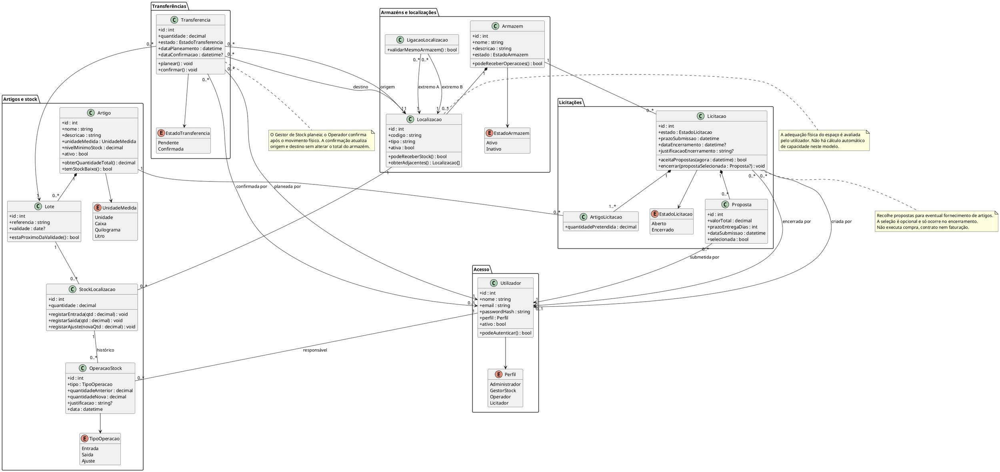

# Diagrama de Classes — DockIn

Modelo conceptual alinhado com a Proposta de Sistema e a Declaração de Âmbito (versão 2), os casos de uso, o modelo de dados e os modelos de comportamento. As operações representam responsabilidades do domínio, sem impor uma tecnologia.

## Restrições do modelo

- O perfil define permissões: Administrador gere utilizadores, armazéns, localizações e artigos; Gestor de Stock gere alocações, transferências planeadas e licitações; Operador regista movimentos e confirma transferências; Licitador consulta licitações abertas e submete as suas propostas. Um utilizador inativo não pode autenticar.
- Uma ligação une duas localizações distintas do mesmo armazém, sem duplicados; a adjacência é bidirecional.
- Cada registo de stock corresponde a um lote numa localização. Quantidades não podem ser negativas; saídas e confirmações de transferência exigem quantidade disponível. Quantidades fracionárias só são aceites em quilogramas e litros.
- A transferência usa localizações ativas do mesmo armazém, tem quantidade positiva e passa de Pendente a Confirmada. O planeamento e a confirmação registam utilizadores e datas distintos.
- Uma licitação tem armazém, prazo e pelo menos um artigo com quantidade pretendida positiva. Recebe propostas apenas enquanto está aberta e dentro do prazo. Cada proposta regista licitador, valor total, prazo de entrega e data de submissão. Ao encerrar, pode selecionar no máximo uma das suas propostas; guarda responsável, data e justificação da decisão. O encerramento não altera stock.
