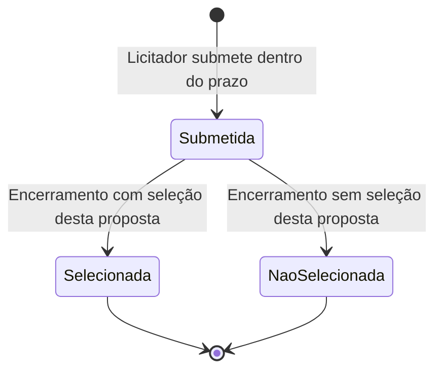

# Diagrama de Estados dos Processos de Licitação — DockIn

**Artefacto:** M2, versão 01  
**Grupo:** G02

A licitação recolhe propostas para eventual fornecimento de artigos. O seu estado persistido é `Aberto` ou `Encerrado`. A seleção de uma proposta é uma decisão registada no encerramento, sem iniciar compra, contrato ou faturação.

## Processo de licitação

```mermaid
stateDiagram-v2
    [*] --> Aberto : Gestor de Stock cria processo válido
    Aberto --> Aberto : Licitador submete proposta válida
    Aberto --> Aberto : Prazo termina; submissão fica bloqueada
    Aberto --> Encerrado : Gestor de Stock encerra com ou sem seleção
    Encerrado --> [*]

    note right of Aberto
        Contém armazém, artigos e quantidades,
        prazo de submissão e responsável.
        Após o prazo continua Aberto até
        o Gestor de Stock o encerrar.
    end note

    note right of Encerrado
        Conserva decisão, justificação,
        responsável e data. Não recebe
        novas propostas nem altera stock.
    end note
```

| Evento | Condições | Resultado |
|---|---|---|
| Criar licitação | Gestor de Stock; armazém; pelo menos um artigo com quantidade positiva; prazo válido. | Estado `Aberto`; guarda criador e dados do processo. |
| Submeter proposta | Licitador ativo; estado `Aberto`; momento dentro do prazo; valor total e prazo de entrega válidos. | Regista proposta, licitador e data; estado da licitação mantém-se `Aberto`. |
| Terminar prazo | Instante atual ultrapassa o prazo. | Novas propostas são recusadas; não há encerramento automático definido. |
| Encerrar com seleção | Gestor de Stock escolhe uma proposta pertencente ao processo. | Estado `Encerrado`; marca apenas essa proposta como selecionada; regista decisão, justificação, responsável e data. |
| Encerrar sem seleção | Gestor de Stock não escolhe proposta, mesmo que existam propostas recebidas. | Estado `Encerrado`; nenhuma proposta selecionada; regista decisão, justificação, responsável e data. |

## Situação das propostas

`Submetida`, `Selecionada` e `NaoSelecionada` descrevem a **situação** da proposta. No modelo de dados atual, essa situação resulta do estado da licitação e do indicador `selecionada`; não exige um novo campo de estado na proposta. Se outra proposta for escolhida, as restantes passam a `NaoSelecionada`. Se não houver escolha, todas passam a `NaoSelecionada`. Uma proposta de licitação ainda aberta permanece `Submetida`, mesmo depois do prazo.

O Licitador consulta apenas as suas propostas; o Gestor de Stock consulta as propostas recebidas. Consulte a [matriz de permissões](../04.20-documentacao-complementar/m2-matriz-permissoes-v01.md), o [modelo de dados](../04.06-modelos-de-dados/modelo-de-dados.md) e a [arquitetura](../04.05-arquitetura/m2-documentacao-arquitetura-v01.md).
