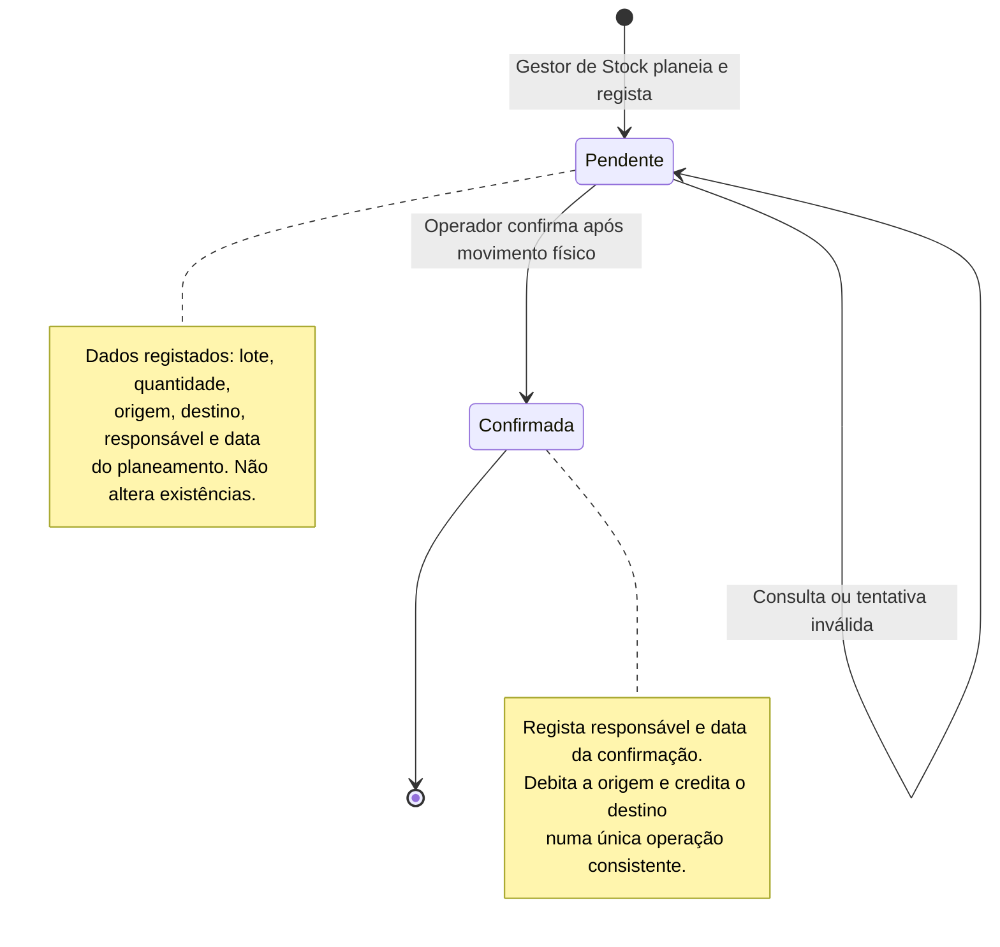

# Diagrama de Estados das Transferências Internas — DockIn

**Artefacto:** M2, versão 01  
**Grupo:** G02

O Gestor de Stock planeia a transferência na interface Web. O Operador realiza o movimento físico e confirma-o na interface mobile. O modelo aprovado prevê dois estados persistidos: `Pendente` e `Confirmada`.

| Transição | Ator | Pré-condições | Efeito |
|---|---|---|---|
| Criação → Pendente | Gestor de Stock | Lote existente; quantidade positiva; origem e destino distintos, ativos e no mesmo armazém. | Regista plano, responsável e data. Não modifica saldos. |
| Pendente → Confirmada | Operador | Movimento físico realizado; transferência ainda pendente; origem e destino ativos; quantidade disponível na origem. | Debita origem, credita destino e regista responsável e data da confirmação na mesma transação. |
| Tentativa inválida → Pendente | Sistema | Falha alguma pré-condição da confirmação. | Recusa a confirmação e conserva estado e saldos. |

Não há neste âmbito cancelamento, rejeição ou confirmação repetida. `Confirmada` é o estado final do processo. A quantidade total do armazém não muda por esta transferência. Uma transferência pendente não reserva stock: a disponibilidade é verificada de novo no momento da confirmação.

Relacionado com [casos de uso](../04.04-casos-de-uso/casos-de-uso.md), [modelo de dados](../04.06-modelos-de-dados/modelo-de-dados.md) e [arquitetura](../04.05-arquitetura/m2-documentacao-arquitetura-v01.md).
