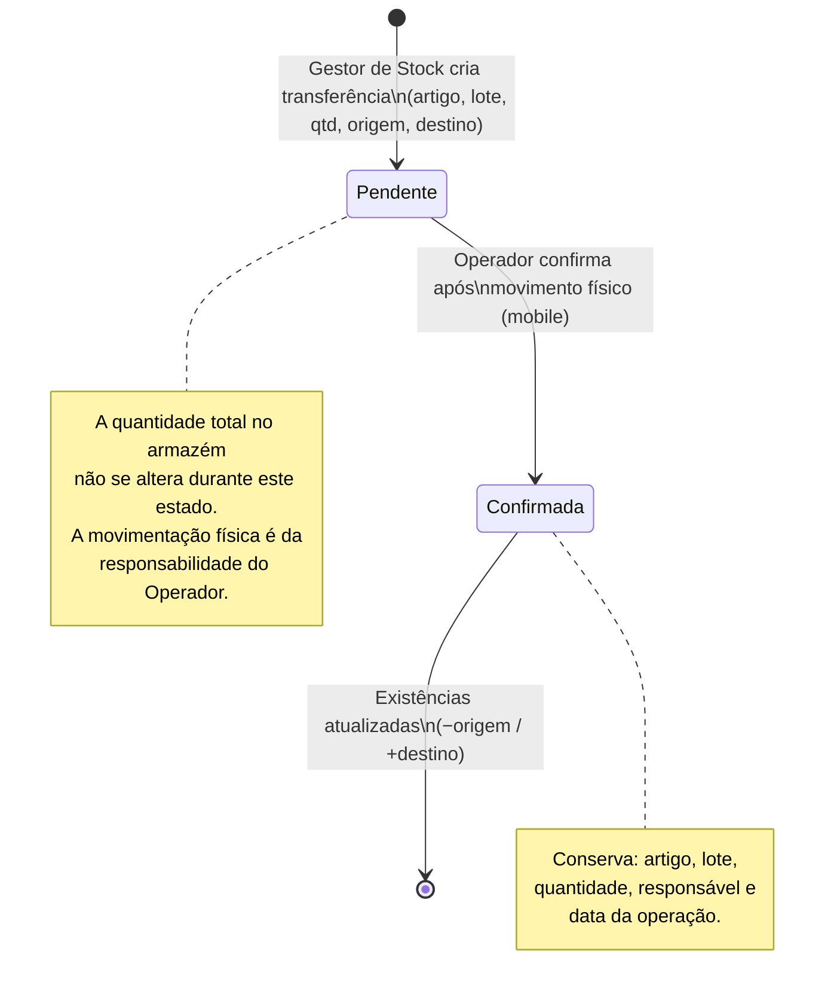
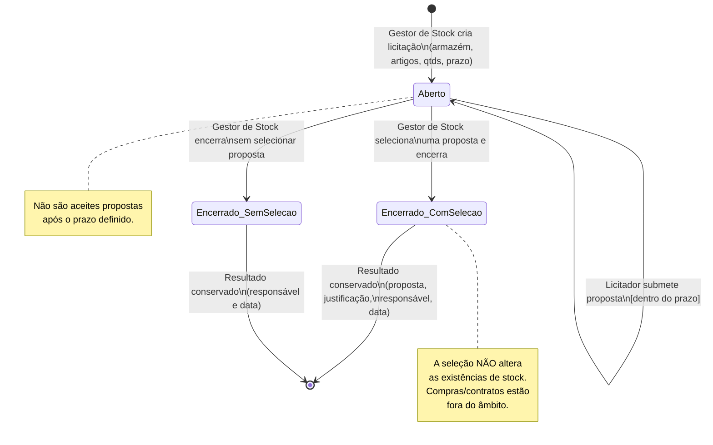
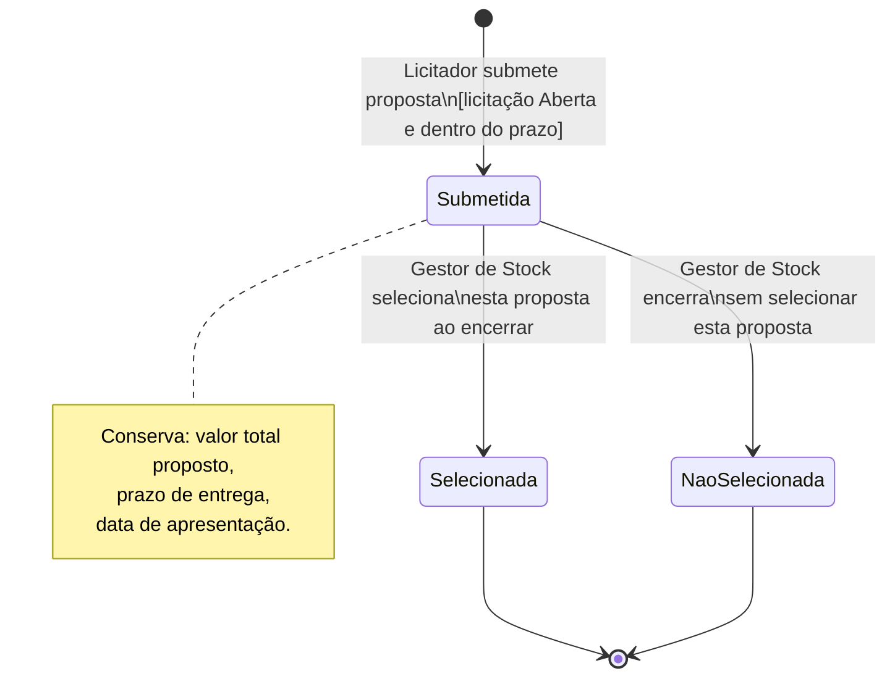
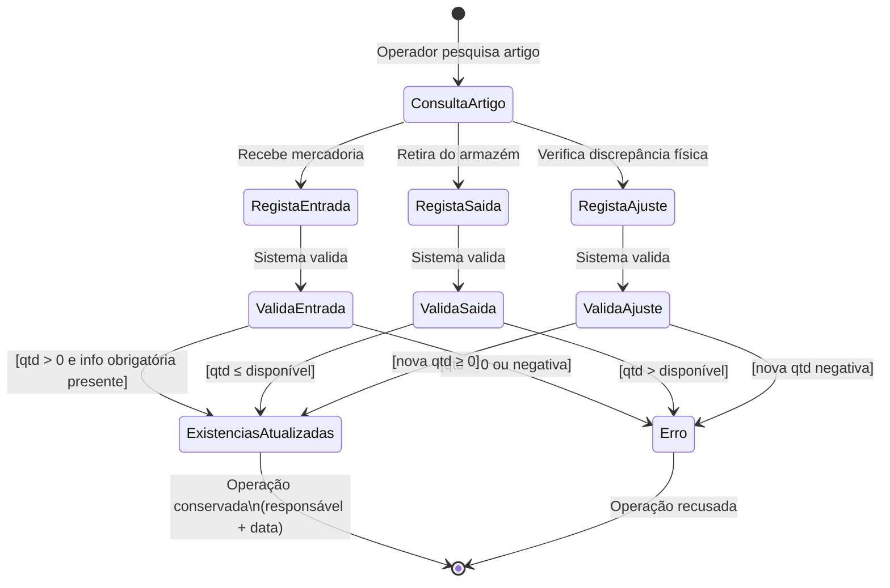
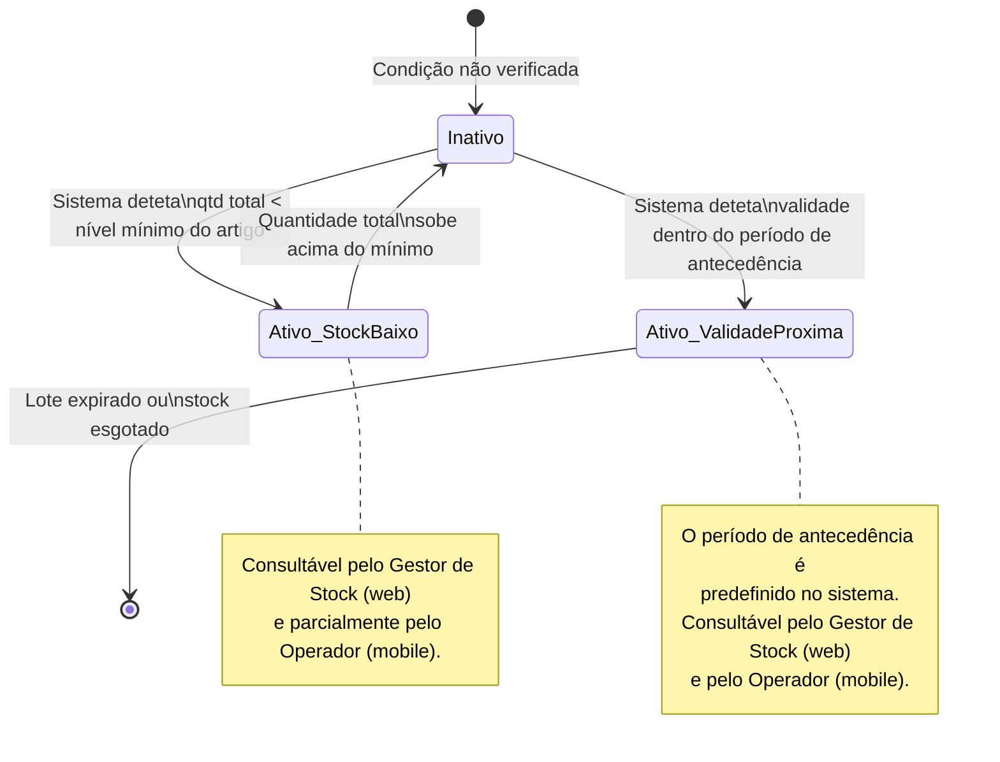
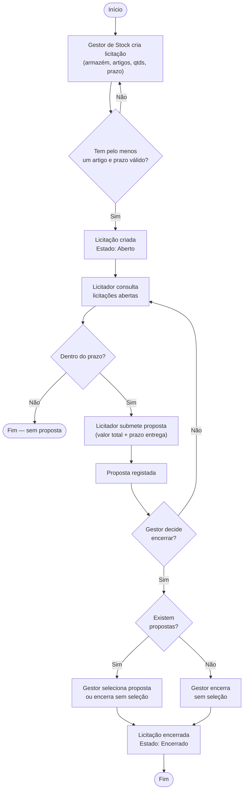
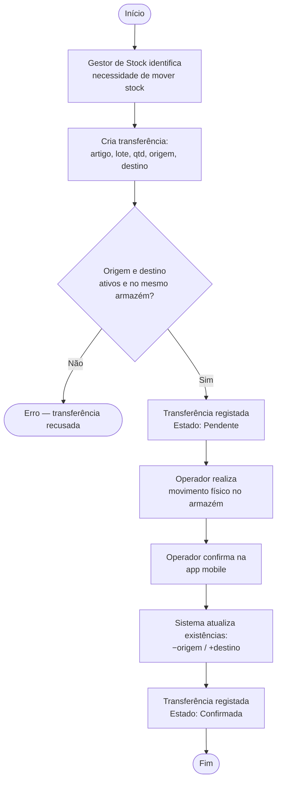

# Modelos de Comportamento — DockIn

---

## 1. Ciclo de Vida de uma Transferência Interna

---

## 2. Ciclo de Vida de uma Licitação

---

## 3. Ciclo de Vida de uma Proposta

---

## 4. Fluxo de Operações de Stock (Operador)

---

## 5. Ciclo de Vida de um Alerta

---

## 6. Diagrama de Atividade — Processo Completo de Licitação

---

## 7. Diagrama de Atividade — Transferência Interna

